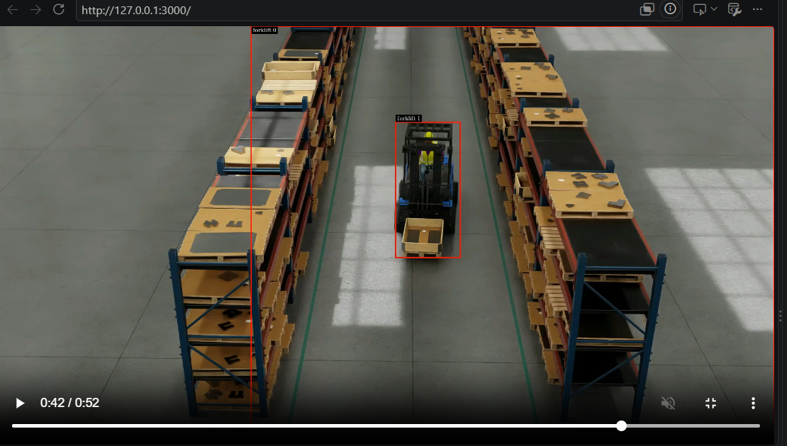
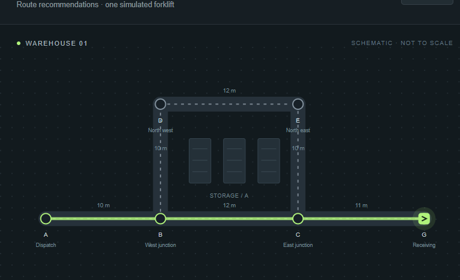
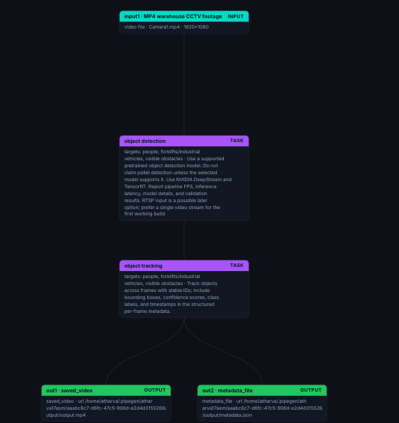

# NavForge

Vision-aware warehouse routing decision support: PipeGen metadata → temporal occupancy → constrained Dijkstra → simulated forklift → live Next.js dashboard.

The supplied PipeGen export is integrated.
## Project explanation

NavForge helps warehouse operators plan routes around temporary aisle obstructions. A static warehouse map describes where a vehicle can travel, while camera observations provide information about what is occupying visible passages. The application combines these inputs to recommend routes for one simulated forklift.

CraftifAI PipeGen defines the perception workflow: warehouse MP4 input, object detection, object tracking, and annotated-video plus structured-metadata outputs. The exported DeepStream pipeline uses TensorRT inference. NavForge's Go adapter consumes the actual exported frame metadata, preserving timestamps, object labels, confidence scores and track IDs. A temporal occupancy engine maps detection ground-contact approximations into configured camera polygons and uses confidence thresholds, persistence and clearing delays to reduce noisy lane changes.

The Dijkstra planner applies lane availability, uncertainty costs, vehicle width/clearance and configured turn constraints. It recalculates routes when occupancy changes and records the cause in SQLite. A Next.js dashboard brings together video inspection, the warehouse graph, mission controls, simulated vehicle motion and the decision timeline.

The integrated recording contains 1,254 frames over 52.25 seconds. The current demonstration replays saved perception output; the vehicle is simulated. 

## Demo screenshots

The screenshots below show the application running locally and the PipeGen Pipeline IR node graph. The repeated video screenshot supplied with the submission is included once.

### Warehouse video with detection output



Recorded warehouse footage playing in the browser, with model-produced forklift labels and bounding boxes visible at approximately 00:42. This shows perception output and application playback; it is not an accuracy benchmark or proof of a fresh GPU run.

### Simulated warehouse route



The operations map shows the planned route from Dispatch (A) through B and C to Receiving (G), with the simulated forklift at the destination. The alternate upper corridor is also visible. This screenshot demonstrates route visualization and simulated mission progress.

### PipeGen Pipeline IR node graph



The PipeGen graph connects **MP4 warehouse CCTV input → object detection → object tracking → saved video and metadata file outputs**. It documents the perception pipeline used to produce the artifacts consumed by NavForge. The original graph export is preserved in [PipelineIR.json](PipelineIR.json).

## Start the integrated application (Windows)

Requires Go 1.26+ and Node.js 22+. From this repository in PowerShell:

```powershell
./scripts/Start-NavForge.ps1
```

Open <http://127.0.0.1:3000>. The launcher builds Go, starts both services, serves Downloads/Camera1.mp4 when available (otherwise the exported MP4), and replays `navforge-gpu-deployment/results/metadata.json` at video time. Press Ctrl+C to stop both services. Logs are in `data/logs/`.

This is **replay of saved inference**, not a new GPU run. Each launch has a fresh ingestion session. SQLite audit history remains under `data/`.

1. Start a simulated mission from A to G.
2. Inspect the perception panel: frame number, timestamps, classes, boxes, track IDs, and input status.
3. Enable “Follow metadata time” to seek the video to the latest observation, or scrub the MP4 independently. Detection boxes appear only when timestamps match.
4. Calibrate visible lanes before expecting occupancy-driven route changes. Unverified regions remain unknown.

## Calibrate against your footage

The default integration config is `configs/warehouse.pipegen.json`: 1920×1080 metadata coordinates, `forklift` and `person` classes, and an **unverified example** polygon. The original 1280×720 example remains in `configs/warehouse.json`.

In the dashboard, choose **Calibrate visible lane**, select a region and graph lane, and click its visible floor corners in order. Check all region associations and detection localization before checking the verification box. Download the configuration, then restart:

```powershell
./scripts/Start-NavForge.ps1 -Config 'C:/Users/Atharva/Downloads/warehouse.calibrated.json'
```

The supplied detection file has 2,319 objects across 1,254 frames. 1,898 boxes cover more than 80% of their frame. Inspect model/parser localization before verifying calibration; these exports do not establish occupancy accuracy. The dashboard flags oversized detections rather than silently filtering them away.

The confirmed source is `Downloads/Camera1.mp4`: 1,254 frames over 52.25 seconds. Browser playback and seeking to 52.208 seconds pass. Video responses disable caching and use a fresh session URL so byte ranges from different recordings cannot be mixed. A decoded-still fallback remains available if another MP4 fails to decode.

## Follow a new PipeGen run

See [the integration guide](docs/INTEGRATION.md) for export deployment and live commands. The Go adapter supports both a shared growing file and `docker exec ... tail` from an existing PipeGen container, without exposing the ingestion listener or assuming a vendor MQTT format.

To follow a fresh container output path (start NavForge before the pipeline):

```powershell
./scripts/Start-NavForge.ps1 -Mode Live -Container craftifai-amd64-v3 -Metadata /opt/navforge-gpu/output/run001/metadata.json -Video 'C:/Users/Atharva/Downloads/Camera1.mp4'
```

Use a new output directory for each run. A matching PipeGen container must already exist and be running. A fresh GPU run could not be verified in this session because that vendor container was absent; the local NVIDIA DeepStream image alone does not supply a verified PipeGen runtime.

## Manual backend/frontend commands

```powershell
$env:GOMODCACHE = Join-Path (Get-Location) 'data/go-mod'
$env:GOCACHE = Join-Path (Get-Location) 'data/go-cache'
go run ./cmd/navforge -config configs/warehouse.pipegen.json -pipegen-metadata navforge-gpu-deployment/results/metadata.json -video navforge-gpu-deployment/results/output.mp4
```

In another terminal:

```powershell
cd web
npm ci --cache ../data/npm-cache
npm run dev
```

For external HTTP producers, set `NAVFORGE_INGEST_TOKEN` to a private random token of at least 24 characters before starting Go. The separate ingestion listener is otherwise disabled. File/container imports call the same validated transactional service directly; they do not require this listener.

## Verification

```powershell
go test ./...
go vet ./...
cd web
npm run typecheck
npm run build
```

Adapter tests include captured vendor fixtures, strict normalization, partial-file following/cancellation, and HTTP ingestion. The causal detour test uses explicitly synthetic calibration and repeated frames; it is not physical calibration evidence. A full import of the supplied recording accepted all 1,254 frames. See [evidence/manifest.json](evidence/manifest.json) for artifact provenance and pending evidence.

## Project layout

Large model engines, ONNX files, generated shared libraries, videos and local caches are ignored by Git but retained locally where needed. See [local artifacts](docs/ARTIFACTS.md) for the paths required to restore a fresh checkout. Source, configs, compile reports, replay metadata and tests remain versionable.

| Path | Purpose |
| --- | --- |
| `cmd/navforge` | API, video serving, input worker, simulator |
| `internal/nav` | Contracts, planner, occupancy, service, SQLite and tests |
| `internal/pipegen` | Actual file-export adapter, replay, local/container following |
| `configs/warehouse.pipegen.json` | Unverified 1920×1080 integration map |
| `web` | Dashboard, timestamp-aligned overlay, calibration config editor |
| `scripts/Start-NavForge.ps1` | Integrated Windows launcher |
| `PipelineIR.json`, `model_stage/`, `pipeline/` | Original supplied PipeGen export |
| `navforge-gpu-deployment/` | Supplied deployment package, active forklift model, results |

API: `GET /health`, `/api/map`, `/api/state`, `/api/occupancy`, `/api/routes/current`, `/api/events?limit=100`, `/api/stream`, optional `/api/video`, and `POST /api/missions`. Authenticated external frames: `POST http://127.0.0.1:8081/internal/perception/events`.

SQLite commits observations, occupancy changes and resulting route decisions atomically. Duplicates and retired sessions remain rejected after restart. Missions and perception reset on restart; audit history and route/graph versions continue. Video timestamps govern occupancy duration; server time governs stale detection. The JSON download includes at most the latest 1,000 events; full history remains in SQLite.

Simulation limitation: mid-edge replanning resets the virtual forklift to the last reached waypoint and records that in the route explanation. ETA uses example speed limits and excludes turn delays. Calibration, detector accuracy, measured inference performance, and a fresh GPU-driven causal route trace remain pending.
