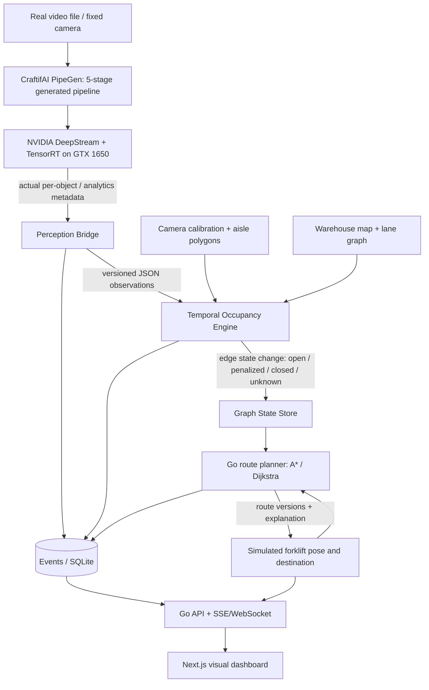
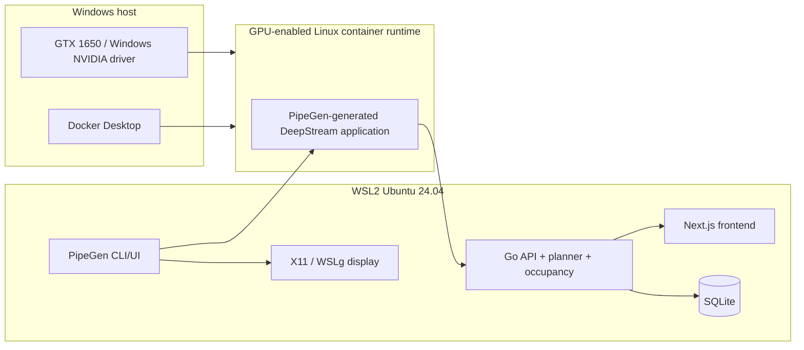

NavForge — High-Level Design (HLD)
Project: Vision-Aware Indoor Navigation and Dynamic Routing for Warehouses
Hackathon: Embedded SF: CraftifAI Physical AI Hackathon
Chosen track: Track A — PipeGen (Perception)
Target development machine: Windows + WSL2 Ubuntu 24.04, NVIDIA GeForce GTX 1650 (4 GB), Docker Desktop
Status: Architecture specification, not an implementation-complete or performance-validated claim
1. Executive summary
NavForge is a navigation decision-support prototype for forklifts and autonomous mobile robots in a mapped indoor warehouse. A fixed camera supplies prerecorded or live video. CraftifAI PipeGen v0.5.1 generates the actual perception pipeline using its required five-stage workflow: Requirement → Pipeline IR → Model → Compiler → Run. Its TensorRT-compiled model and NVIDIA DeepStream runtime detect/tracks people and other supported obstacle classes. A bridge transforms actual inference metadata into a defined event schema, an occupancy engine updates specific mapped passages, and a Go path planner re-routes a simulated forklift. A Next.js dashboard displays the video, map, route changes, causal explanations, and measured metrics.
Product claim in MVP: route recommendations respond to camera-visible obstacles in pre-calibrated areas. Not claimed: autonomous forklift operation, vehicle localization from a single RGB feed, depth estimation, safety certification, control of real machinery, full 3D drone navigation, or guaranteed detection of all obstacle types.
2. Problem and goals
Problem
Indoor GPS is unreliable, and a static route planner has no knowledge of temporary aisle obstructions. Cameras already positioned around industrial spaces can supply observations that change routing decisions, provided those observations are mapped to the floor plan and fused conservatively.
MVP outcome
When a mapped aisle becomes occupied in real recorded video, the system should update route availability and re-route one simulated forklift between a defined start and destination. The route should not oscillate excessively because of detection noise. When the zone becomes visibly clear for a configured interval, the system may reopen the aisle and replan.
In scope
- Exactly one calibrated fixed camera, one 2D warehouse map, one simulated vehicle.
- Single video input (MP4 first), with optional USB/RTSP after baseline works.
- Person detection as minimum reliable class; pallet/forklift/box detection only if the selected verified model supports them and test footage permits evaluation.
- Track IDs when the generated PipeGen pipeline supports tracking.
- Polygonal occupancy regions and their mapping to graph edges.
- Event deduplication, temporal filtering, unknown/stale perception states.
- A*/Dijkstra shortest-path baseline, graph-edge closures/penalties, route versioning.
- A live-updating browser dashboard, metrics and evidence export.
Out of scope
- Physical actuation, real vehicle navigation or motion control.
- FirmGen, ESP32, STM32 or the Closed Loop hardware bonus in the baseline Track A submission.
- Drone flight planning (3D map, SLAM/VIO and flight control are a separate future project).
- Multi-camera cross-camera tracking, warehouse-wide localization, simultaneous fleet routing.
- Automatic metric-to-world geometry inferred from a single monocular camera.
3. Hackathon requirements: binding compliance matrix
Source: user-provided official hackathon problem statement. Track A mandatory requirements are distinct from optional bonuses.
Requirement	Mandatory?	NavForge implementation	Proof / artifact	Acceptance gate
Use CraftifAI PipeGen, not an unrelated YOLO-only notebook	YES	PipeGen produces the vision pipeline	Saved PipeGen project and export folder	Real video passes through PipeGen-generated app
All five PipeGen stages: Requirement, Pipeline IR, Model, Compiler, Run	YES	Capture each stage and save configs	Screenshots + project/export metadata	All five completed and identifiable
At least one TensorRT engine and PipeGen speed report	YES	Compile supported ONNX detector (FP32 baseline; FP16 if valid)	.engine where exported, compiler output, speed report	Engine created and corresponding report captured
Live pipeline run on NVIDIA GPU / Jetson, using video file/camera/RTSP	YES	GTX 1650 executes DeepStream pipeline on MP4 first	Run log, live demonstration/screencast, GPU evidence	Observable processing of real video
Actionable output, not just bounding boxes	YES	JSON events from real inference → aisle changes → replan	Event log + dashboard route-change record	Triggered replan traceable to actual detection
Tool must be load-bearing	YES	Occupancy updater consumes real PipeGen events; disabling it blocks perception-driven replanning	Demonstration showing causal chain	No fake demo-only obstacle state presented as PipeGen detection
Source repository with PipeGen export folder	YES	Commit source/configs/export where licenses permit; link binary artifacts when too large	Repo + manifest	Reproducible instructions, evidence preserved
Project description, IR screenshot, TensorRT report	YES	Submission evidence bundle	evidence/ and written description	Bundle complete
INT8 model or Jetson deployment	Bonus only	Optional later	Actual benchmark and comparison	Do not claim unless demonstrated
PipeGen + FirmGen physical closed loop	Bonus only	Not in MVP	Requires real board and actual action	Never claim with simulated forklift
FirmGen Live Intelligence	Bonus Track B	Not applicable	N/A	N/A

Important: A Docker DeepStream --version-all output is not equivalent to successfully compiling and running a PipeGen TensorRT model. This is a remaining task.
4. High-level logical architecture

Trust and responsibility boundaries
1. PipeGen/DeepStream owns perception. The custom application must not replace its inference with mock detections in the judged live path.
2. Bridge owns compatibility. Raw DeepStream/PipeGen output formats are discovered empirically; the bridge adapts from the actual export to a stable internal schema. Do not assume PipeGen emits a particular MQTT payload until verified.
3. Occupancy owns mapping and temporal logic. Detection is not the same as a globally localized obstacle.
4. Planner owns routing advice. It never sends physical actuation commands.
5. Simulator owns virtual motion only. It must visibly label its simulated state.
5. Deployment architecture

Environment caveat: Docker GPU passthrough, DeepStream 8.0 version output and TensorRT 10.9 runtime visibility were verified in the existing environment. PipeGen v0.5.1 currently fails its own prerequisite checks, reporting no daemon and missing locally installed NVIDIA Container Toolkit despite the Docker Desktop socket working. The agent must resolve this via vendor-supported WSL2 deployment before asserting the end-to-end system runs. Do not silently skip the PipeGen checks, patch its binaries, or claim a native Docker Engine is essential without verifying vendor guidance.
Hardware limit
4 GB VRAM. Default to one pipeline, one stream, 640–720p input, one lightweight detector, 1–batch inference; capture actual GPU memory utilization, FPS and failure modes. Model compatibility/performance remains empirical. Use headless/file-output sinks if WSL graphics are unstable.
6. Mapping, perception and occupancy model
6.1 Camera-space mapping
- Store video resolution and manually defined polygons for visible aisle regions (e.g. aisle_AB, aisle_AC).
- Map each polygon to an edge or set of edges in warehouse.json.
- For per-object attribution, use bounding-box ground-contact approximation (x + w/2, y + h) or a calibrated ground plane only if defensible.
- If objects are above ground / camera view geometry invalid, label attribution uncertain and avoid asserting real-world location.
- Optional planar homography based on four or more non-collinear floor landmarks; verify reprojection error and reject bad calibration.
- Unseen passages are unknown, not automatically clear.
6.2 Observation and occupancy logic
Inputs: object class, confidence, bbox, track ID, frame/video timestamp, camera ID and optional PipeGen/DeepStream ROI metadata. Maintain per-ROI states:
UNKNOWN → CLEAR → SUSPECTED_BLOCKED → BLOCKED → CLEARING → CLEAR
Default configurable policy (prototype values; tune against test footage):
- SUSPECTED_BLOCKED: relevant obstacle on >= 3 consecutive frames.
- BLOCKED: >= 0.5 seconds persistent evidence, within confidence thresholds; presence of a person may immediately trigger a conservative risk penalty rather than claiming full impassability.
- CLEARING: no supporting occupancy for 1 second; wait >= 2 seconds to fully reopen.
- UNKNOWN: stream stopped, no timestamps, perception stale beyond 2 seconds, or calibration ambiguous.
- BLOCKED denotes a planner exclusion or demonstration hazard rule, not real-world proof that an aisle is physically impassable.
- Track ID is scoped to camera and session; never rely on stability across restart.
Fail-safe interpretation for demo: Unknown regions are handled with conservative costs or excluded under strict-safety mode; expose policy in UI, never silently mark them open.
6.3 Vehicle geometry and graph
Map nodes describe navigable waypoints; edges include length, allowed travel direction, lane width, speed limit, turn penalty, and bound camera ROI IDs. Vehicle profile includes clearance envelope/width, turning restrictions and speed cap. Agent must reject invalid edges even without obstacles, not just compute unconstrained shortest path.
Weight function, for feasible edge e:
weight(e) = distance(e) + lambda_risk * risk(e) + lambda_turn * turnPenalty(e) + lambda_uncertainty * unknown(e)
For forbidden/blocked edges use +Infinity (removed from search). Use A* with admissible Euclidean heuristic in units compatible with path length; use Dijkstra as an oracle/baseline. If weighted penalties complicate admissibility, use zero heuristic initially.
6.4 Change propagation
Perception bridge → validated timestamped observation → ROI state transition → graph version increment → planner recalculation → new route with reason and causal_event_id. Ignore duplicate/out-of-order events per camera sequence or timestamp policy; ensure replay can reproduce the same result.
7. Logical services and APIs
Service	Language	Responsibilities
PipeGen-generated vision app	Vendor runtime	Decode, detect, track/analytics as generated, inference, real metadata
Perception adapter	Go (or minimal Python only if DeepStream integration demands it)	Parse actual output, normalize, validate, emit events
Occupancy engine	Go	ROI attribution, hysteresis, TTL, edge state updates
Routing engine	Go	A* / Dijkstra, constraints, route version and reason
Simulator	Go or TypeScript	Simulated pose, mission and route following
API	Go/Echo or net/http	Map, vehicle, incidents, route, stream
Persistence	SQLite	Observations, occupancy transitions, route decisions
Web	Next.js + TypeScript	Video, warehouse map, path overlay, chronology, metrics

Suggested HTTP routes
- GET /health → service health and perception-connected state.
- GET /api/map → nodes, edges, ROIs, camera calibration version.
- POST /api/missions → {start_node, goal_node, vehicle_profile_id}.
- GET /api/routes/current → route, version, edges, distance, reason, causation.
- GET /api/occupancy → ROI and edge state with timestamps.
- GET /api/events?limit=N → durable events.
- GET /api/stream → SSE changes (route, occupancy, simulator).
- POST /internal/perception/events → authenticated local-only validated bridge ingestion; never trust browser-submitted events as real inference.
Canonical observation (illustrative contract)
{
  "schema_version": "1.0",
  "event_id": "cam01-run001-frame0123-track07",
  "source": "pipegen-deepstream",
  "camera_id": "cam01",
  "session_id": "run001",
  "frame_index": 123,
  "video_ts_ms": 4920,
  "track_id": "7",
  "class_label": "person",
  "confidence": 0.91,
  "bbox_xywh_px": [318, 226, 70, 174],
  "image_size": [1280, 720],
  "roi_ids": ["aisle_BC"]
}
The example above is synthetic documentation, not generated evidence. Do not invent an exporter format; write the adapter only after observing actual PipeGen output.
Route-change event
{
  "schema_version": "1.0",
  "route_version": 4,
  "mission_id": "mission-1",
  "trigger_event_id": "cam01-run001-frame0123-track07",
  "trigger_edge_id": "B-C",
  "trigger_state": "BLOCKED",
  "old_edges": ["A-B", "B-C", "C-G"],
  "new_edges": ["A-D", "D-E", "E-G"],
  "reason": "Aisle B-C was marked blocked by persistent camera observation",
  "simulated": true
}
8. Demo walkthrough
1. Load pre-calibrated warehouse map and recorded MP4. Camera coverage is highlighted.
2. Choose a virtual forklift start and destination. Baseline path appears.
3. Start actual PipeGen-generated video pipeline (visible status: GPU inference running).
4. A person/obstacle appears in mapped aisle. Raw observation and ROI confidence appear in inspector.
5. After temporal confirmation, ROI/edge becomes penalized or blocked.
6. Planner produces a new route with reason, affected edge and causal event ID.
7. Simulated forklift follows the revised path (clearly labeled as simulated).
8. Clearing the obstacle reopens an edge after hysteresis; route can be recomputed.
9. Show PipeGen IR screenshot, TensorRT compilation/speed report, live execution log and JSON evidence.
Fallback for camera footage without usable aisle correspondence: choose an alternate pre-annotated video. Do not quietly inject fabricated observations as though they came from PipeGen.
9. Evidence, measurements and evaluation
Mandatory proof
- Screenshot of each PipeGen stage / Pipeline IR (most important screenshot explicitly required).
- Real TensorRT engine compilation and PipeGen speed report (include model, precision and input dimensions).
- Real processed video/live pipeline and inference metadata generated by PipeGen.
- JSON event → mapped aisle state → route version causal chain.
- Repository with PipeGen export folder as allowed, setup notes and config manifests.
Scientific evaluation (added engineering quality)
- 3+ videos or segments: clear, transient obstruction, sustained obstruction; include partial occlusion if possible.
- Hand-labeled obstruction intervals and aisle IDs used as ground truth.
- Precision, recall, F1 of occupancy events, false closure per hour, route validity, time-to-replan, unnecessary replans, replan count per minute.
- Static A* vs direct vision-aware closure vs hysteresis/confidence-aware closure; same graph and scenarios.
- Pipeline FPS, p50/p95 inference/processing latency if exposed, GPU memory, CPU load.
- Report denominator, sample size, event timestamp semantics and provenance; no invented speed reports.
No target metric is an achieved result unless measured. Successful demo requires functional correctness; numerical targets are stretch goals.
10. Risks and mitigations
Risk	Impact	Response
PipeGen prerequisite rejects WSL2 Docker Desktop	Blocks required tool	Follow vendor-specific WSL2 path; preserve old Docker setup; seek official support if necessary
4 GB VRAM OOM	Failed inference	Single lightweight detector, 640–720p, batch=1, lean tracker, monitor memory
PipeGen catalog lacks pallet detector	Incorrect promises	Support people first; explicitly report class limitations; optional vetted model later
JSON/MQTT export differs from assumptions	Integration blocked	Empirically inspect real output; adapter interface + fixtures; no fake producer
Perspective/occlusion breaks occupancy	Unsafe mapping	Fixed cameras, calibrated ROIs, unknown state, ground-truth tests
Single camera lacks full coverage	False free-space assumption	Colorize uncovered lanes as unknown; don't treat unseen as clear
Route oscillation	Poor UX	Hysteresis + debounce + cooldown + versioning
WSL2 display/codec failures	Demo broken	Prefer verified video-file input and headless saved-video/JSON path
No real vehicle hardware	Can't claim autonomous physical control	Explicitly present decision-support and simulation; no Closed Loop bonus claim

11. Security and operational constraints
- Run ingestion listener on loopback or internal Docker network, not public Internet.
- Strict JSON schema validation and size limits, stable event IDs, bounded queues.
- Files sourced from the user must be considered untrusted; do not interpolate them into shell commands.
- No unsafe real-vehicle actuation endpoint.
- Config and dataset versions recorded per run; benchmark results immutable once published.
- Privacy: use footage you have rights to, mask identifying individuals if required, avoid retaining unnecessary footage.
12. Source links and provenance
Hackathon statement: user-provided official Embedded SF / CraftifAI Physical AI hackathon specification (Track A five stages, TensorRT report, live NVIDIA run, actionable output, repo and evidence; physical board only mandatory for Track B).
CraftifAI developer downloads: https://developer.craftifai.com/dashboard?tab=downloads
NVIDIA DeepStream analytics documentation: https://docs.nvidia.com/metropolis/deepstream/7.1/text/DS_plugin_gst-nvdsanalytics.html
DeepStream 8.0 analytics metadata: https://docs.nvidia.com/metropolis/deepstream/8.0/sdk-api/structNvDsAnalyticsObjInfo.html  
Actual PipeGen export formats, catalog models and WSL2 launcher compatibility are not verified yet. Agent must discover them rather than assume.